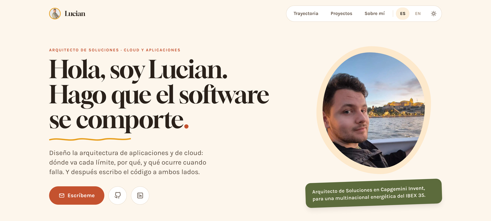

# Portfolio

Web personal: [lucianandreinegoita.dev](https://lucianandreinegoita.dev/es)

[](https://lucianandreinegoita.dev/es)

Trayectoria, proyectos destacados, formación y certificaciones, en español e inglés.
Cada experiencia y cada proyecto tiene su propia página de detalle.

## Stack

- [Astro 5](https://astro.build) con contenido en `src/data/{es,en}.json`
- Tailwind CSS, tema claro y oscuro
- GSAP para la entrada del hero y las apariciones al hacer scroll
- Fuentes Gloock y Karla servidas desde el propio sitio (fontsource)
- Despliegue en GitHub Pages con dominio propio

## Desarrollo

```bash
npm install
npm run dev       # http://localhost:4321
npm run build     # astro check + build en dist/
```

Los textos y la lista de proyectos se editan en `src/data/es.json` y `src/data/en.json`;
las páginas se generan a partir de ahí.
